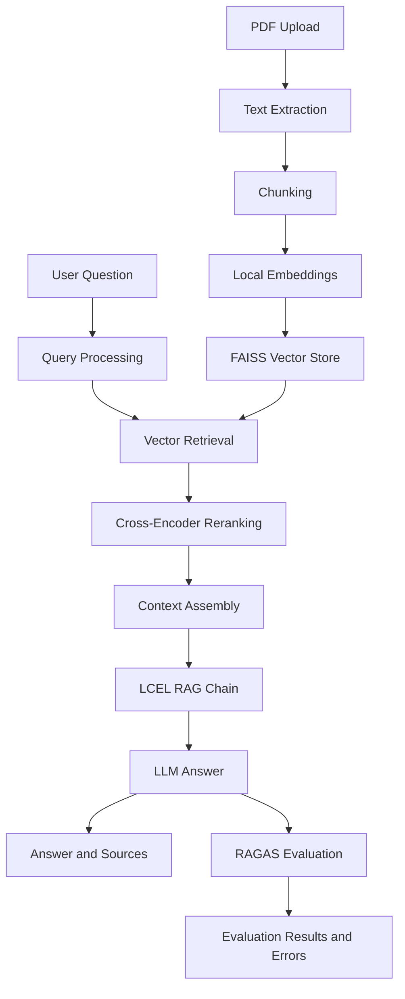

# Lecture Notes Q&A Assistant

**Problem Statement:** Build a single-source Retrieval-Augmented Generation (RAG) assistant using embeddings, FAISS, cross-encoder reranking, and RAGAS evaluation.

**Selected Domain: Option 2 — Lecture Notes Q&A**

**Deployment:** Local development only. No public hosted application URL is currently available.

## Overview

The Lecture Notes Q&A Assistant is a Retrieval-Augmented Generation (RAG) application that allows users to upload lecture-note PDFs and ask questions grounded in their content.

The application extracts text from uploaded PDFs, divides it into overlapping chunks, generates embeddings, and stores searchable vectors in FAISS. When a user asks a question, the system retrieves candidate passages, reranks them using a cross-encoder, and passes the selected context to a language model to generate an answer with source attribution.

The project also includes query processing, retrieval evaluation, and RAGAS-based evaluation to help assess answer quality and troubleshoot failures.

## Features

- **PDF ingestion:** Upload lecture-note PDFs and extract text for processing.
- **Text chunking:** Split extracted content into overlapping chunks.
- **Vector search:** Generate local embeddings and store searchable vectors using FAISS.
- **Cross-encoder reranking:** Reorder retrieved passages before selecting context for answer generation.
- **RAG pipeline:** Generate context-grounded answers through a LangChain Expression Language (LCEL) chain.
- **Query processing:** Support query routing and decomposition for multi-part questions.
- **Source attribution:** Display retrieved source passages alongside generated answers.
- **RAGAS evaluation:** Evaluate faithfulness, answer relevancy, and context precision when the configured evaluation service is available.
- **Evaluation logging:** Record evaluation status, metric results, and metric errors for troubleshooting.
- **Web interface:** Interact with the assistant through a Next.js frontend.
- **Evaluation artifacts:** Include recorded retrieval and reranking experiment results.

## Architecture



## Tech Stack

| Component | Technology |
|---|---|
| Backend API | Python, FastAPI |
| Frontend | Next.js, React, TypeScript |
| RAG orchestration | LangChain, LCEL |
| Vector store | FAISS |
| Embeddings | Sentence Transformers |
| Reranking | Hugging Face Cross-Encoder |
| Answer generation | Gemini API through an OpenAI-compatible endpoint |
| Evaluation | RAGAS |
| API documentation | FastAPI / Swagger UI |

## Project Structure

```text
lecture-notes-rag/
├── backend/
│   ├── app/
│   │   ├── __init__.py
│   │   ├── config.py
│   │   ├── evaluation.py
│   │   ├── ingestion.py
│   │   ├── main.py
│   │   ├── query_processing.py
│   │   ├── query_router.py
│   │   ├── rag_chain.py
│   │   ├── ragas_evaluator.py
│   │   ├── retrieval.py
│   │   ├── schemas.py
│   │   └── vector_store.py
│   ├── tests/
│   │   ├── test_chunking.py
│   │   ├── test_citations.py
│   │   ├── test_evaluation_manual.py
│   │   ├── test_query_processing.py
│   │   ├── test_rag_chain_manual.py
│   │   ├── test_ragas_evaluator_manual.py
│   │   ├── test_reranker_manual.py
│   │   └── test_vector_store_manual.py
│   ├── .env.example
│   ├── .gitignore
│   ├── evaluate_reranking.py
│   ├── evaluate_retrieval_metrics.py
│   └── requirements.txt
├── frontend/
│   ├── app/
│   │   ├── globals.css
│   │   ├── layout.tsx
│   │   └── page.tsx
│   ├── components/
│   │   ├── ChatInput.tsx
│   │   ├── ChatMessage.tsx
│   │   ├── ChatWindow.tsx
│   │   ├── EvaluationPanel.tsx
│   │   ├── PdfUploader.tsx
│   │   ├── SourcePanel.tsx
│   │   └── VoiceInput.tsx
│   ├── lib/
│   │   └── api.ts
│   ├── global.d.ts
│   ├── next-env.d.ts
│   ├── package.json
│   ├── package-lock.json
│   └── tsconfig.json
├── .gitignore
├── README.md
├── reranking_evaluation.txt
└── retrieval_metrics_report.txt
```

## Prerequisites

Install the following before running the project:

- Python 3.11, or another version compatible with the backend dependencies.
- Node.js and npm.
- Git.
- A Google AI Studio API key for Gemini-based answer generation and LLM-based evaluation.

The embedding and reranking models run locally after their model files have been downloaded. The initial setup may take longer because these files need to be downloaded.

## Getting Started

### 1. Clone the repository

Using HTTPS:

```bash
git clone https://github.com/ashutosh-jha-web/lecture-notes-rag.git
cd lecture-notes-rag
```

SSH is also supported if your GitHub SSH key is configured:

```bash
git clone git@github.com:ashutosh-jha-web/lecture-notes-rag.git
cd lecture-notes-rag
```

### 2. Set up the Python environment

Run these commands from the repository root:

```bash
python -m venv .venv
source .venv/bin/activate
python -m pip install --upgrade pip
pip install -r backend/requirements.txt
```

Create your local backend environment file:

```bash
cp backend/.env.example backend/.env
```

Edit `backend/.env` and configure your API key and model settings.

Example configuration:

```dotenv
GOOGLE_API_KEY=your_google_ai_studio_api_key
GEMINI_CHAT_MODEL=gemini-2.5-flash

EMBEDDING_MODEL=sentence-transformers/all-MiniLM-L6-v2
RERANKER_MODEL=cross-encoder/ms-marco-MiniLM-L-6-v2

UPLOAD_DIR=data/uploads
FAISS_DIR=data/faiss_index
EVAL_LOG_PATH=eval/results.jsonl

CHUNK_SIZE=900
CHUNK_OVERLAP=150
RETRIEVAL_K=12
RERANK_TOP_N=4
MAX_UPLOAD_MB=25
```

Use the variable names and supported values in `backend/.env.example` as the source of truth for your checked-out version. The example above illustrates the main configuration settings; optional variables may also be available.

**Important:** Never commit your real API key. Keep `backend/.env` and other local environment files out of Git.

### 3. Start the backend

From the repository root, activate the virtual environment if it is not already active:

```bash
source .venv/bin/activate
```

Start the FastAPI application:

```bash
PYTHONPATH=backend python -m uvicorn app.main:app --app-dir backend --reload
```

The backend should be available at:

- API base URL: `http://localhost:8000`
- Interactive API documentation: `http://localhost:8000/docs`

Keep this terminal running.

### 4. Set up and start the frontend

Open a second terminal at the repository root:

```bash
cd frontend
npm install
```

Create a local frontend environment file named `frontend/.env.local` containing:

```dotenv
NEXT_PUBLIC_API_BASE_URL=http://localhost:8000
```

Start the frontend:

```bash
npm run dev
```

Open the application in your browser:

`http://localhost:3000`

Keep both the backend and frontend running while using the application.

## How to Use the Application

1. Start the backend and frontend.
2. Open the application at `http://localhost:3000`.
3. Upload a lecture-notes PDF.
4. Wait for document processing and indexing to complete.
5. Enter a question about the uploaded material.
6. Review the generated answer and its source passages.
7. Inspect the evaluation panel to see available RAGAS scores and any reported evaluation errors.

Answers depend on the content and quality of the uploaded document, retrieval results, and behavior of the configured language model.

## Retrieval and Cross-Encoder Reranking

The retrieval pipeline retrieves candidate passages from FAISS and uses a cross-encoder to rerank them before selecting context for the answer-generation chain.

The recorded experiment uses the following settings:

| Setting | Value |
|---|---:|
| Initial retrieval candidates (`RETRIEVAL_K`) | 12 |
| Passages retained after reranking (`RERANK_TOP_N`) | 4 |

### Before-and-after comparison

The following figures are taken from the recorded `reranking_evaluation.txt` experiment. They represent three evaluated questions, not a comprehensive benchmark.

| Metric | FAISS baseline | After reranking |
|---|---:|---:|
| Mean Recall@4 | 1.000 | 1.000 |
| Mean MRR | 0.833 | 0.833 |
| Mean nDCG@4 | 0.876 | 0.878 |

**Interpretation:**

- Mean Recall@4 remained unchanged at 1.000 in this small experiment.
- Mean MRR remained unchanged at 0.833.
- Mean nDCG@4 increased slightly from 0.876 to 0.878.
- The ordering of passages changed across the evaluated examples.
- Results varied by question: nDCG improved for some examples, decreased for another, and remained unchanged for another.

These results demonstrate that reranking changes passage ordering, with a small aggregate nDCG improvement in this particular experiment. They do **not** establish that reranking improves every query or produces a substantial overall quality improvement. A larger labeled dataset is needed for stronger conclusions.

### Reproducing the reranking experiment

From the repository root, activate the root virtual environment and run:

```bash
source .venv/bin/activate
PYTHONPATH=backend python backend/evaluate_reranking.py
```

Review the script's configuration and output before comparing a new run with the recorded results. Model versions, input documents, and evaluation settings can affect the outcome.

## Retrieval Evaluation

The repository also includes `retrieval_metrics_report.txt`, which contains recorded retrieval evaluation results.

Retrieval metrics help assess how effectively relevant passages are found and ranked. They should be interpreted alongside the queries, expected evidence, evaluation methodology, and dataset size. Results from a small test set may not generalize to other lecture notes.

## Query Processing

The query-processing functionality supports breaking multi-part questions into smaller questions and routing queries through the configured retrieval workflow.

Query decomposition can help when a question contains multiple information needs. Routing can help direct a query through the appropriate processing path. Actual behavior depends on the implementation and configured models.

## RAGAS Evaluation

The application supports evaluation using three RAGAS metrics:

- **Faithfulness:** Measures whether the generated answer is supported by the retrieved context.
- **Answer relevancy:** Measures how relevant the answer is to the user's question.
- **Context precision:** Measures whether relevant retrieved context is ranked ahead of irrelevant context.

Evaluation requires a functioning configured LLM endpoint. Results may be complete, partial, or unavailable when API credentials are invalid, the provider is unavailable, rate limits are reached, or quota is exhausted.

The application records evaluation status and metric errors to help distinguish successful evaluation from partial or failed evaluation. A failed metric does not necessarily mean that answer generation failed; evaluation can fail independently of the answer-generation step.

RAGAS scores are evaluation signals, not guarantees of correctness. They should be interpreted alongside source attribution and manual review.

## Evaluation Artifacts

The repository contains these recorded evaluation outputs:

- `reranking_evaluation.txt` — reranking experiment results, including baseline and reranked retrieval metrics.
- `retrieval_metrics_report.txt` — recorded retrieval evaluation metrics.

These are saved outputs from particular runs. They are not guarantees of performance across all documents, questions, models, or environments.

## API Reference

Once the backend is running, visit:

`http://localhost:8000/docs`

The interactive FastAPI documentation exposes the application's registered endpoints, request schemas, and response schemas. This is the recommended reference for the API available in the checked-out version of the project.

## Configuration Reference

The following table describes the main configuration variables. Confirm the exact supported variables and defaults in `backend/.env.example` and the backend configuration module.

| Variable | Purpose |
|---|---|
| `GOOGLE_API_KEY` | API authentication for the configured Google AI service |
| `GEMINI_CHAT_MODEL` | Model used for answer generation |
| `GEMINI_EVALUATION_MODEL` | Optional model for evaluation; the configured default depends on the backend implementation |
| `EMBEDDING_MODEL` | Local text-embedding model |
| `RERANKER_MODEL` | Cross-encoder used to rerank candidate passages |
| `CHUNK_SIZE` | Target text chunk size |
| `CHUNK_OVERLAP` | Overlap between adjacent chunks |
| `RETRIEVAL_K` | Number of initial retrieval candidates |
| `RERANK_TOP_N` | Number of passages retained after reranking |
| `MAX_UPLOAD_MB` | Configured upload-size limit |
| `UPLOAD_DIR` | Local upload storage location |
| `FAISS_DIR` | Local FAISS index storage location |
| `EVAL_LOG_PATH` | Location for evaluation logs |

## Testing

The backend contains tests covering areas such as chunking, citations, query processing, and vector-store behavior. Some files are explicitly named as manual evaluation or integration checks; do not assume every test is an automated unit test suitable for routine CI execution.

From the repository root, activate the virtual environment and run the backend test suite:

```bash
source .venv/bin/activate
PYTHONPATH=backend pytest backend/tests/ -q
```

Tests that require live model services, API credentials, or manual execution may have additional requirements. Check each test file before running those checks.

## Limitations

- **Local deployment:** The application is currently intended to run locally; no public hosted URL is provided.
- **Document support:** Extraction quality depends on the PDF's structure and whether its text is accessible. Scanned documents may require OCR support.
- **Retrieval quality:** Relevant passages may be missed or ranked imperfectly.
- **Model dependency:** Answer quality depends on the selected model and the retrieved evidence.
- **External API dependency:** Gemini-based generation and evaluation require valid credentials, provider availability, and sufficient quota.
- **Local model resources:** Embedding and reranking models require downloads, storage, and computational resources.
- **Evaluation coverage:** Recorded retrieval and reranking experiments are limited and should not be treated as universal performance claims.
- **Production readiness:** Authentication, deployment hardening, monitoring, and other production requirements would need further work before public deployment.

## Future Improvements

- Add automated end-to-end tests for the full upload-to-answer workflow.
- Evaluate retrieval and answer quality on a larger labeled question set.
- Add OCR support for scanned PDFs.
- Record latency, resource usage, and reproducible evaluation summaries.
- Improve error categorization and retry behavior for external model-service failures.
- Document and implement deployment and production security requirements.

## License

No license has been specified yet. Unless a license is added to the repository, reuse and redistribution permissions should not be assumed. Contact the repository owner regarding permission to reuse this project.
