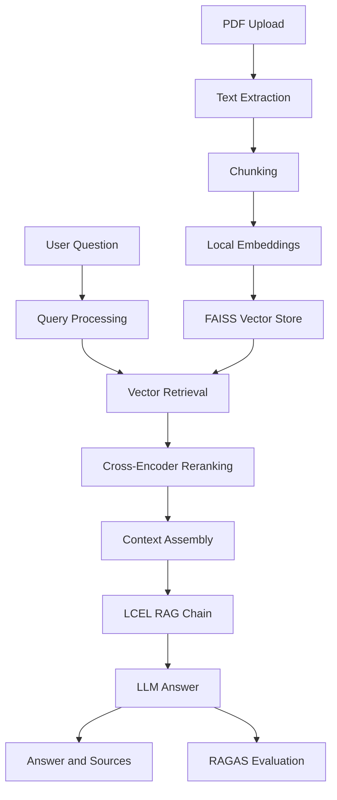

# Lecture Notes Q&A Assistant

A Retrieval-Augmented Generation (RAG) application that allows users to upload lecture-note PDFs and ask questions about their content. The system retrieves relevant passages, reranks them using a cross-encoder, and generates answers with source attribution.

## Features

- **PDF ingestion:** Upload lecture-note PDFs and split extracted text into overlapping chunks.
- **Vector search:** Generate local embeddings and store searchable vectors in FAISS.
- **Cross-encoder reranking:** Rerank retrieved passages to prioritize relevant context before answer generation.
- **RAG pipeline:** Retrieve context and generate answers using a LangChain Expression Language (LCEL) chain.
- **Query processing:** Support query routing and decomposition for multi-part questions.
- **Source attribution:** Display retrieved sources alongside answers.
- **RAGAS evaluation:** Evaluate answer faithfulness, answer relevancy, and context precision when the required model and API quota are available.
- **Evaluation logging:** Record evaluation status, metric scores, and metric errors for troubleshooting.
- **Web interface:** Interact with the assistant through a Next.js frontend.

## Architecture



## Tech Stack

| Component | Technology |
|---|---|
| Backend | Python, FastAPI |
| Frontend | Next.js, React, TypeScript |
| RAG orchestration | LangChain, LCEL |
| Vector store | FAISS |
| Embeddings | Sentence Transformers |
| Reranking | Hugging Face Cross-Encoder |
| Answer generation | Gemini API through an OpenAI-compatible endpoint |
| Evaluation | RAGAS |


## Project Structure

```text
lecture-notes-rag/
├── backend/
│   ├── app/
│   │   ├── __init__.py
│   │   ├── config.py
│   │   ├── evaluation.py
│   │   ├── ingestion.py
│   │   ├── main.py
│   │   ├── query_processing.py
│   │   ├── query_router.py
│   │   ├── rag_chain.py
│   │   ├── ragas_evaluator.py
│   │   ├── retrieval.py
│   │   ├── schemas.py
│   │   └── vector_store.py
│   ├── tests/
│   │   ├── test_chunking.py
│   │   ├── test_citations.py
│   │   ├── test_evaluation_manual.py
│   │   ├── test_query_processing.py
│   │   ├── test_rag_chain_manual.py
│   │   ├── test_ragas_evaluator_manual.py
│   │   ├── test_reranker_manual.py
│   │   └── test_vector_store_manual.py
│   ├── .env.example
│   ├── .gitignore
│   ├── evaluate_reranking.py
│   ├── evaluate_retrieval_metrics.py
│   └── requirements.txt
├── frontend/
│   ├── app/
│   │   ├── globals.css
│   │   ├── layout.tsx
│   │   └── page.tsx
│   ├── components/
│   │   ├── ChatInput.tsx
│   │   ├── ChatMessage.tsx
│   │   ├── ChatWindow.tsx
│   │   ├── EvaluationPanel.tsx
│   │   ├── PdfUploader.tsx
│   │   ├── SourcePanel.tsx
│   │   └── VoiceInput.tsx
│   ├── lib/
│   │   └── api.ts
│   ├── global.d.ts
│   ├── next-env.d.ts
│   ├── package.json
│   ├── package-lock.json
│   └── tsconfig.json
├── .gitignore
├── README.md
├── reranking_evaluation.txt
└── retrieval_metrics_report.txt
```


## Prerequisites

- Python 3.11 or a version compatible with the backend dependencies
- Node.js and npm
- Git
- A Google AI Studio API key for Gemini-based answer generation and LLM-based evaluation

## Setup

### 1. Clone the repository

```bash
git clone git@github.com:ashutosh-jha-web/lecture-notes-rag.git
cd lecture-notes-rag
```

HTTPS alternative:

```bash
git clone https://github.com/ashutosh-jha-web/lecture-notes-rag.git
cd lecture-notes-rag
```

### 2. Configure the backend

From the repository root:

```bash
python -m venv .venv
source .venv/bin/activate
python -m pip install --upgrade pip
pip install -r backend/requirements.txt
```

Create a local environment file:

```bash
cp backend/.env.example backend/.env
```

Edit `backend/.env` and set your API key and model configuration. Never commit real API keys.

Example configuration:

```dotenv
GOOGLE_API_KEY=your_google_ai_studio_api_key
GEMINI_CHAT_MODEL=gemini-2.5-flash

EMBEDDING_MODEL=sentence-transformers/all-MiniLM-L6-v2
RERANKER_MODEL=cross-encoder/ms-marco-MiniLM-L-6-v2

UPLOAD_DIR=data/uploads
FAISS_DIR=data/faiss_index
EVAL_LOG_PATH=eval/results.jsonl

CHUNK_SIZE=900
CHUNK_OVERLAP=150
RETRIEVAL_K=12
RERANK_TOP_N=4
MAX_UPLOAD_MB=25
```

The embedding and reranking models are downloaded locally when first needed. The first run may take longer because model files need to be downloaded.

### 3. Start the backend

From the repository root:

```bash
source .venv/bin/activate
PYTHONPATH=backend python -m uvicorn app.main:app --app-dir backend --reload
```

The API should be available at:

- API base URL: `http://localhost:8000`
- Interactive API documentation: `http://localhost:8000/docs`

### 4. Configure and start the frontend

Open a second terminal at the repository root:

```bash
cd frontend
npm install
```

Create `frontend/.env.local` with:

```dotenv
NEXT_PUBLIC_API_BASE_URL=http://localhost:8000
```

Start the frontend:

```bash
npm run dev
```

Open `http://localhost:3000` in your browser.

## How to Use

1. Start the backend and frontend.
2. Upload a lecture-notes PDF through the interface.
3. Wait for document processing and indexing to finish.
4. Ask a question about the uploaded material.
5. Review the generated answer and its source passages.
6. Inspect evaluation results when metric evaluation succeeds.

## Retrieval and Reranking

The retrieval pipeline initially retrieves up to 12 candidate passages and reranks them using a cross-encoder. The configured pipeline passes up to 4 top-ranked passages to the downstream chain.

The repository includes a reranking evaluation script:

```bash
cd backend
source .venv/bin/activate
PYTHONPATH=. python evaluate_reranking.py
```

The script can be used to inspect changes in candidate ordering. A change in ranking demonstrates that reranking affects the results; it does not by itself prove improved answer quality. Relevance should be assessed against the query and its expected evidence.

## Query Processing

The query-processing module supports breaking multi-part questions into smaller questions and routing queries through the configured retrieval workflow. The quality of decomposition and routing depends on the implementation and its configured models.

## RAGAS Evaluation

The evaluation module is designed to calculate:

- **Faithfulness:** Whether the answer is supported by the retrieved context.
- **Answer relevancy:** Whether the answer addresses the user's question.
- **Context precision:** Whether relevant retrieved context is ranked ahead of irrelevant context.

Evaluation may fail or return partial results if the configured LLM service is unavailable, API credentials are invalid, rate limits are reached, or quota is exhausted. The application records evaluation errors so these cases can be investigated.

## Evaluation Artifacts

The repository includes:

- `reranking_evaluation.txt` — recorded reranking experiment output.
- `retrieval_metrics_report.txt` — recorded retrieval metrics output.

These files represent recorded evaluation runs and should not be interpreted as guarantees of performance on every document or query.

## API Reference

Once the backend is running, visit `http://localhost:8000/docs` to inspect the actual FastAPI endpoints, request schemas, and responses.

## Configuration

Important settings are available through environment variables:

| Variable | Purpose |
|---|---|
| `GOOGLE_API_KEY` | API authentication |
| `GEMINI_CHAT_MODEL` | Configured Gemini model |
| `EMBEDDING_MODEL` | Local embedding model |
| `RERANKER_MODEL` | Cross-encoder model |
| `CHUNK_SIZE` | Target text chunk size |
| `CHUNK_OVERLAP` | Overlap between adjacent chunks |
| `RETRIEVAL_K` | Initial retrieval candidate count |
| `RERANK_TOP_N` | Number of passages retained after reranking |
| `MAX_UPLOAD_MB` | Maximum configured upload size |

## Limitations

- Answer quality depends on document extraction, retrieval relevance, and LLM behavior.
- Local embedding and reranking models require resources and may take time to download.
- RAGAS evaluation depends on a working LLM endpoint and sufficient API quota.
- Uploaded PDFs, local FAISS indexes, environment files, and evaluation logs are local runtime data and are not included in the repository by default.

## Future Improvements

- Add automated integration tests for the complete upload-to-answer workflow.
- Compare retrieval and answer quality using a larger, labeled query dataset.
- Add robust handling for scanned PDFs and OCR.
- Add reproducible evaluation summaries and latency measurements.
- Document deployment and production security requirements.

## License

No license has been specified yet. Contact the repository owner before reusing this project.
